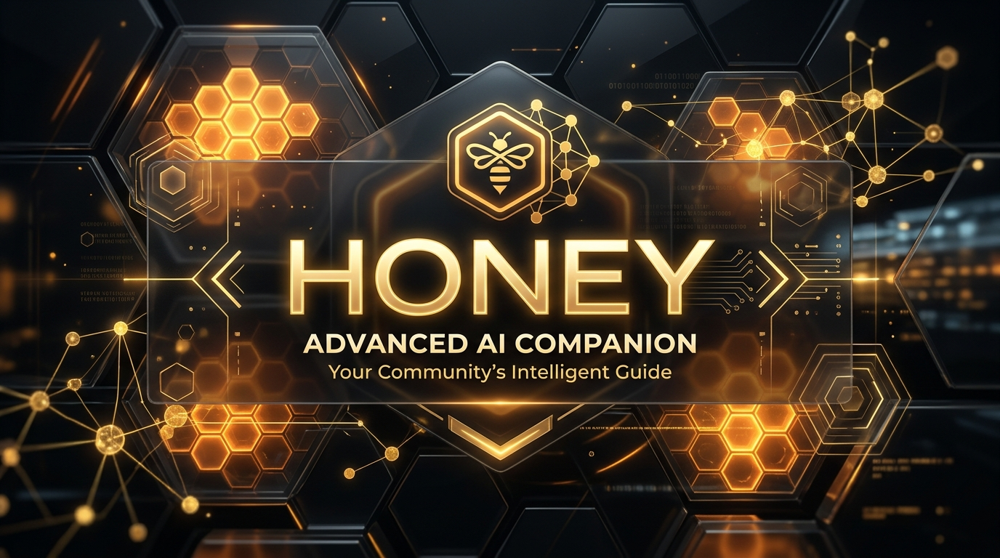

<p align="center">
  
</p>

# 🍯 Honey — Autonomous AI Discord Administration Agent

> Autonomous Discord server management driven entirely by natural-language English commands (`/go <instruction>`), powered by zero-cost AI models (Google Gemini 2.0 Flash / Groq / Ollama) and Discord.js v14.

---

## 🌟 Key Features

- **Single Primary Interface (`/go`):** Accepts natural, ordinary English instructions. No hardcoded prompt templates or fixed command libraries.
- **Dynamic Infrastructure Planning:** AI reasons over real-time server state (channels, categories, roles, permissions) and synthesizes strict, deterministic JSON action plans.
- **Zero-Cost Guarantee:** 100% free operation with no paid fallbacks. Supported zero-cost providers:
  - **Google Gemini 2.0 Flash / 1.5 Flash:** Free tier via [Google AI Studio](https://aistudio.google.com/) (No credit card needed).
  - **Groq (Llama 3.3 70B):** Generous free tier via [Groq Console](https://console.groq.com/).
  - **Ollama:** 100% offline, local, unlimited model execution.
- **Strict 3-Phase Execution:**
  1. **Phase A (Pre-check):** Verifies requester authority, bot permissions, role hierarchy, boost tier, and duplicate resources.
  2. **Phase B (Validated Execution):** Topological dependency ordering (categories/roles created before channels), safe 350ms rate-limit spacing, and transient retry backoff.
  3. **Phase C (Post-Verification):** Re-fetches Discord live state after mutation to confirm changes succeeded before posting the report.
- **Interactive Ticket System:** Generates a complete persistent ticket panel with Discord buttons (`🎫 Open Ticket`), creates private 1-on-1 channels, and includes a `🔒 Close Ticket` button.
- **Safety Safeguards & Rollback (`/undo`):** High-impact or destructive actions (e.g., deleting channels/roles, banning members) trigger interactive button confirmation. All created resources are tracked in an in-memory ledger for one-click reversal.

---

## 📁 Project Architecture

```
discord-admin-bot/
├── bot.js                  # Main client entry point & event dispatchers
├── deploy-commands.js      # REST script to deploy slash commands
├── package.json            # Pinned dependencies (Discord.js v14, @google/generative-ai, Zod)
├── .env.example            # Environment template with free-tier guide
├── .gitignore              # Ignores .env and node_modules
├── src/
│   ├── config.js           # Configuration loader & zero-cost validator
│   ├── logger.js           # Structured logger with automatic secret redaction
│   ├── schemas.js          # Strict Zod schemas for all 22+ actions & plans
│   ├── capabilities.js     # Discord capability registry & unsupported operation guards
│   ├── permissions.js      # Authorization & role hierarchy guards
│   ├── server-state.js     # Compact, prompt-injection-sanitized guild state extractor
│   ├── ai-provider.js      # Multi-provider zero-cost AI client (Gemini / Groq / Ollama)
│   ├── planner.js          # Intent reasoning engine with bounded replanning
│   ├── executor.js         # Deterministic Discord API execution engine
│   ├── verification.js     # Live state post-check & rich embed generator
│   ├── confirmations.js    # Interactive button confirmation for high-impact actions
│   ├── recovery.js         # Error classifier & safe rollback ledger
│   ├── tickets.js          # Persistent interactive ticket system
│   └── commands.js         # /go, /undo, and /diagnostics command router
└── tests/                  # Automated test suite (25 tests covering all systems)
    ├── schemas.test.js
    ├── permissions.test.js
    ├── server-state.test.js
    ├── logger.test.js
    ├── recovery.test.js
    ├── executor.test.js
    ├── tickets.test.js
    ├── verification.test.js
    └── confirmations.test.js
```

---

## 🚀 Setup & Installation Guide

### Step 1: Create Your Discord Bot Application

1. Go to the [Discord Developer Portal](https://discord.com/developers/applications) and click **New Application**.
2. Name your bot (e.g. `Admin Agent`) and click **Create**.
3. Under the **Bot** tab:
   - Click **Reset Token** to copy your **Bot Token**.
   - Under **Privileged Gateway Intents**, turn **ON**:
     - **Server Members Intent** (Required for hierarchy checks, moderation, and role assignments)
     - **Message Content Intent**
   - Click **Save Changes**.
4. Under the **General Information** tab:
   - Copy your **Application ID** (This is your `DISCORD_CLIENT_ID`).
5. Under **OAuth2 > URL Generator**:
   - Check `bot` and `applications.commands`.
   - Check `Administrator` under Bot Permissions.
   - Copy the generated URL and open it in your browser to invite the bot to your server.
   > **Important:** In your Discord server's **Server Settings > Roles**, drag the Bot's role **above** any roles you want it to manage! Discord does not allow any bot to manage roles higher than its own.

---

### Step 2: Get a Free AI API Key

Choose any zero-cost option:
- **Google Gemini (Recommended):** Go to [Google AI Studio](https://aistudio.google.com/), click **Get API Key**, and create a free key (No credit card required).
- **Groq:** Go to [Groq Console](https://console.groq.com/) and create a free API key.
- **Ollama:** Install [Ollama](https://ollama.com/) locally and run `ollama run llama3.1:8b`.

---

### Step 3: Configure Environment

Navigate to the bot directory and copy `.env.example`:
```powershell
cd "c:\Users\rosenkrvz\Documents\Projects & Dev\Web Development\nodefolio\discord-admin-bot"
copy .env.example .env
```

Open `.env` and fill in:
```env
DISCORD_TOKEN=your_bot_token_here
DISCORD_CLIENT_ID=your_application_id_here
DISCORD_GUILD_ID=your_test_server_id_here  # Optional: enables instant slash command update

AI_PROVIDER=gemini
GEMINI_API_KEY=your_free_ai_studio_api_key_here
GEMINI_MODEL=gemini-2.0-flash
```

---

### Step 4: Deploy Slash Commands & Start

1. **Deploy Slash Commands:**
   ```powershell
   npm run deploy
   ```
2. **Start the Bot:**
   ```powershell
   npm start
   ```

---

## 🧪 Running Automated Tests

Run the comprehensive 25-test suite:
```powershell
npm test
```

---

## 💡 Example Natural Language Prompts (`/go`)

- **Full Community Setup:**
  `/go prompt: Set up a gaming community with categories for Announcements, General Chat, and Voice Lounges. Create roles for Gamer (green) and Mod (cyan).`
- **Private VIP Area:**
  `/go prompt: Create a VIP role in gold and make a private category and chat channel only accessible to VIPs.`
- **Interactive Ticket System:**
  `/go prompt: Create a complete ticket system in #support-tickets so users can click a button to contact staff.`
- **Security Audit:**
  `/go prompt: Check what is wrong with my permissions and audit dangerous settings.`
- **Member Management:**
  `/go prompt: Give @John the VIP role and change his nickname to Captain John.`
- **Reversal:**
  `/undo` (Reverses all channels and roles created in the most recent `/go` session).
